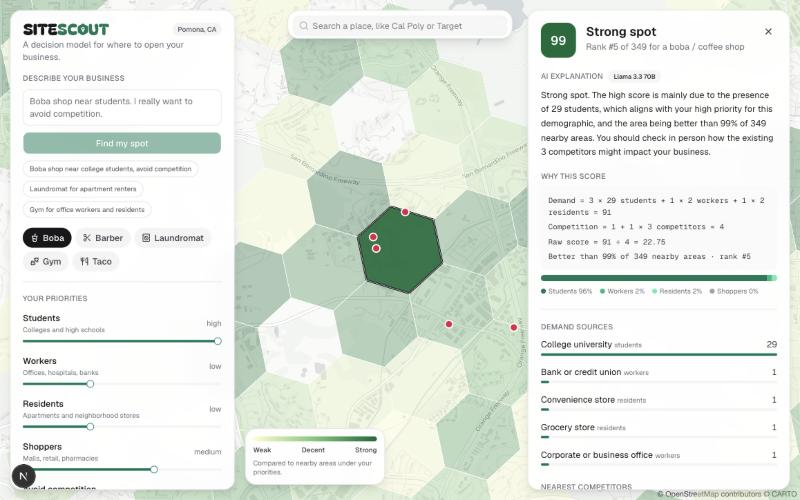
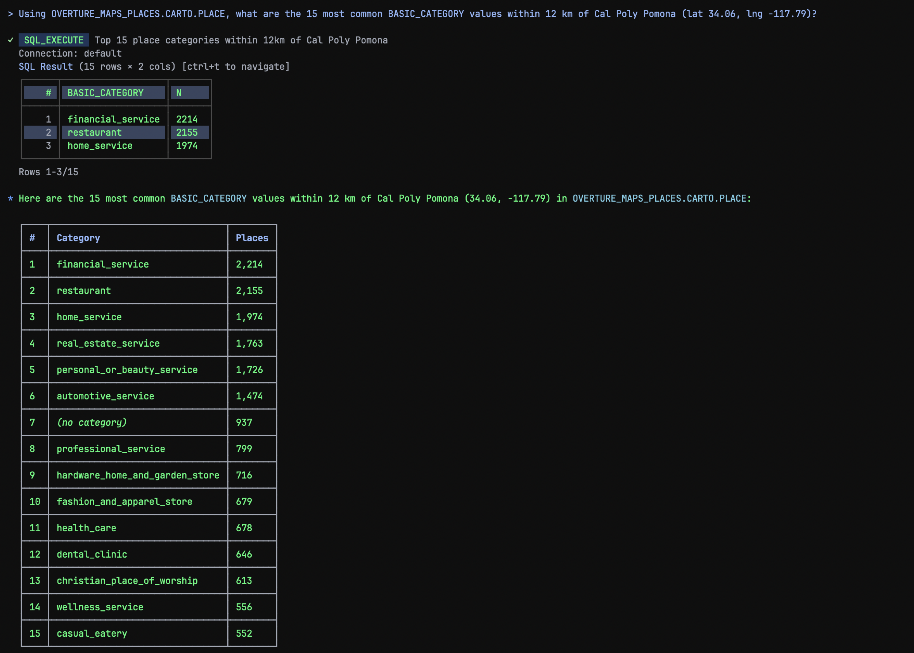

# Site Scout


**Where should a small business open?** Site Scout scores every neighborhood-sized hexagon within 12 km of Cal Poly Pomona for a business type you pick, using a transparent decision model you can see and change. Click a spot and an open-weight LLM explains the score in plain English, using only the model's numbers.

**The model decides. The LLM explains.**

Built at Bronco MiniHacks 2026 by Kanwar Ghuman and Sirui Wang. Tracks: Local Businesses, Best Use of Snowflake, Best Open-Source AI Project.

<!-- TODO: add an app screenshot here, e.g.  -->

## What it does

- **Sign up and onboard.** Pick your business type (boba/coffee, barber/salon, laundromat, gym, taco/fast casual) and set your priorities. They're saved to your account, so the map opens ready for you.
- **Score map.** Every ~0.7 km² hexagon gets a 0 to 100 score. Sliders change what matters and the map rescores instantly in the browser.
- **Why this score.** Click a hex to see the exact math, the places that drive demand there, the nearest competitors, and a plain-English explanation.
- **Describe your business in plain English.** The LLM turns a sentence into a business type and starting weights. A keyword fallback runs if the LLM is unavailable.
- **Compare two spots.** The code picks the winner; the LLM explains the tradeoff.
- **Search and report.** Search a place you know and download a one-page report to bring to a landlord or lender.

## The decision model

For a hex with counts of each demand group and of competitors:

```
demand = Σ weight × count        (students, workers, residents, shoppers)
raw    = demand ÷ (1 + competition_weight × competitors)
score  = percentile rank of raw among all hexes (0 to 100)
```

- Weights run from 0 to 3. Each business type has defaults (boba leans on students; a laundromat leans on residents and avoiding competition).
- The score is a **percentile, not a probability of success**: 90 means "beats 90% of nearby areas under your priorities."
- The model is deterministic and lives in [`lib/model.ts`](lib/model.ts). The server recomputes scores itself before calling the LLM, and the LLM never picks a winner.

## How it works

```
ONCE, IN SNOWFLAKE (sql/setup.sql)
Overture Maps Places (Snowflake Marketplace, via CARTO)
  → PLACES: places within 12 km of Cal Poly Pomona, tagged with H3_POINT_TO_CELL_STRING(geometry, 8)
  → DRIVER_CATEGORIES / COMPETITOR_CATEGORIES: Overture categories bucketed by pattern
  → HEX_FEATURES: per business type and hex, COUNT_IF per demand group + competitor count

EVERY REQUEST, IN THE APP
Next.js API routes (Snowflake via key-pair auth) → lib/model.ts scores in the browser
  → deck.gl H3HexagonLayer on MapLibre + CARTO Positron basemap
  → click → Llama 3.3 70B via Snowflake Cortex AI_COMPLETE explains → cached in Neon Postgres
```

- **Snowflake:** the Marketplace dataset, geospatial (`ST_DWITHIN`) and H3 functions, and **Cortex `AI_COMPLETE`**, so the open-weight model runs inside Snowflake, next to the data.
- **CoCo:** we used Snowflake CoCo (Cortex Code CLI) to explore the Overture Places data and its category strings and to build the pipeline SQL in [`sql/`](sql/).
  <!-- TODO: add a CoCo screenshot, e.g.  -->
- **Reliability:** if Snowflake is unreachable the app serves exported data from [`data/`](data/). It retries dropped connections, rate-limits LLM routes (20 requests per minute per IP), and caches every LLM result.
- **Accounts:** email and password (hashed with Node's built-in scrypt), with database-backed sessions in an httpOnly cookie. Tables `users` and `sessions` live in Neon. The map requires an account unless `MOCK_MODE=true`.

## Open-weight AI

- **Model:** [Llama 3.3 70B Instruct](https://huggingface.co/meta-llama/Llama-3.3-70B-Instruct) (`llama3.3-70b`), called through [Snowflake Cortex `AI_COMPLETE`](https://docs.snowflake.com/en/sql-reference/functions/ai_complete). See [`lib/llm.ts`](lib/llm.ts) and the prompts in [`lib/prompts.ts`](lib/prompts.ts).
- **License:** [Llama 3.3 Community License](https://github.com/meta-llama/llama-models/blob/main/models/llama3_3/LICENSE). The weights are openly downloadable, so anyone can self-host the model instead of relying on a closed API.
- **What it does:** turns a plain-English business description into model settings, explains a hex's score, and explains a two-spot comparison. It only ever sees the numbers the model computed.

**Built with Llama.** Llama 3.3 is licensed under the Llama 3.3 Community License, Copyright © Meta Platforms, Inc. All Rights Reserved.

## Run locally

1. Node 20.19+, 22.12+ or 24+ (Prisma's requirement).
2. `npm install` (also generates the Prisma client and copies the MapLibre worker into `public/`).
3. Create `.env.local`:
   ```
   SNOWFLAKE_ACCOUNT=
   SNOWFLAKE_USER=            # a service user with key-pair auth
   SNOWFLAKE_ROLE=SYSADMIN
   SNOWFLAKE_WAREHOUSE=COMPUTE_WH
   SNOWFLAKE_DATABASE=SITE_SCOUT
   SNOWFLAKE_SCHEMA=APP
   SNOWFLAKE_PRIVATE_KEY_B64= # base64 of the PEM private key
   DATABASE_URL=              # Neon, pooled
   DATABASE_URL_UNPOOLED=     # Neon, direct (migrations)
   MOCK_MODE=false
   ```
   Never commit this file. `.env*` is already in `.gitignore`.
4. **Snowflake data:** get the Overture Maps Places listing (by CARTO) from the Snowflake Marketplace, then run [`sql/setup.sql`](sql/setup.sql) as `SYSADMIN`. The LLM needs Cortex access to `llama3.3-70b` in your region (or cross-region inference enabled).
5. **Postgres tables:** `npm run db:migrate`. On networks that block port 5432, use `npm run db:migrate:https`. If Prisma reports `P3005` because the tables were created by the HTTPS script, mark the earlier migration as applied first: `npx prisma migrate resolve --applied 20261023190000_init_ai_cache`.
6. `npm run dev` and open http://localhost:3000.

**No Snowflake or Postgres?** Set `MOCK_MODE=true`. The map runs on the exported data in `data/`, the LLM features fall back to simple rules, and the login gate is off.

## Limitations

- Counts come from Overture's places data, which isn't complete. Apartments in particular are sparse, so "residents" is a rough proxy.
- Competitors are counted only inside each hex, not its neighbors, so a competitor just across a hex boundary doesn't count against the next hex.
- No rent, real foot traffic, demographics or zoning yet. Next layers: Census demographics, rent as a cost penalty, and a saved owner report.

## Logo files

In `public/`: `sitescout_twotone.svg` (original, dark background), `sitescout_wordmark_light.svg` (for white surfaces), `sitescout_wordmark_dark.svg` (transparent, for dark surfaces), `sitescout_mark.svg` (hex-pin icon) and `sitescout_mark_twotone.svg` (favicon, also `app/icon.svg`).

## Built with

| Part | What we used |
|---|---|
| Data and AI | Snowflake (Marketplace, H3 + geospatial functions, Cortex `AI_COMPLETE`), CoCo, Llama 3.3 70B |
| App | Next.js, React, TypeScript, Tailwind CSS, shadcn/ui, Base UI, class-variance-authority, lucide-react, sonner, cmdk, next-themes |
| Map | MapLibre GL JS, react-map-gl, deck.gl (`H3HexagonLayer`), h3-js, CARTO Positron basemap |
| Storage | Neon Postgres, Prisma (`@prisma/client`, `@prisma/adapter-neon`), `@neondatabase/serverless` |
| Server | `snowflake-sdk`, dotenv |
| Hosting | Vercel |

Open-source licenses of the libraries above: MIT (Next.js, React, deck.gl, react-map-gl, shadcn/ui, Base UI, sonner, cmdk, Neon serverless), Apache-2.0 (Prisma, snowflake-sdk, h3-js, class-variance-authority), BSD-3-Clause (MapLibre GL JS), ISC (lucide-react).

## Data and attribution

- **Places:** © [Overture Maps Foundation](https://overturemaps.org/). Overture Places is published under [CDLA-Permissive-2.0](https://cdla.dev/permissive-2-0/) and Apache-2.0 depending on the source; see [Overture's attribution page](https://docs.overturemaps.org/attribution/). Accessed through CARTO's listing on the Snowflake Marketplace.
- **Basemap:** © [CARTO](https://carto.com/attribution/), © [OpenStreetMap contributors](https://www.openstreetmap.org/copyright).
- **Model:** Built with Llama. Llama 3.3 Community License, © Meta Platforms, Inc.
- **Fonts:** Geist (SIL Open Font License). Logo lettering based on Bagel Fat One (SIL Open Font License).

## License

[MIT](LICENSE)
